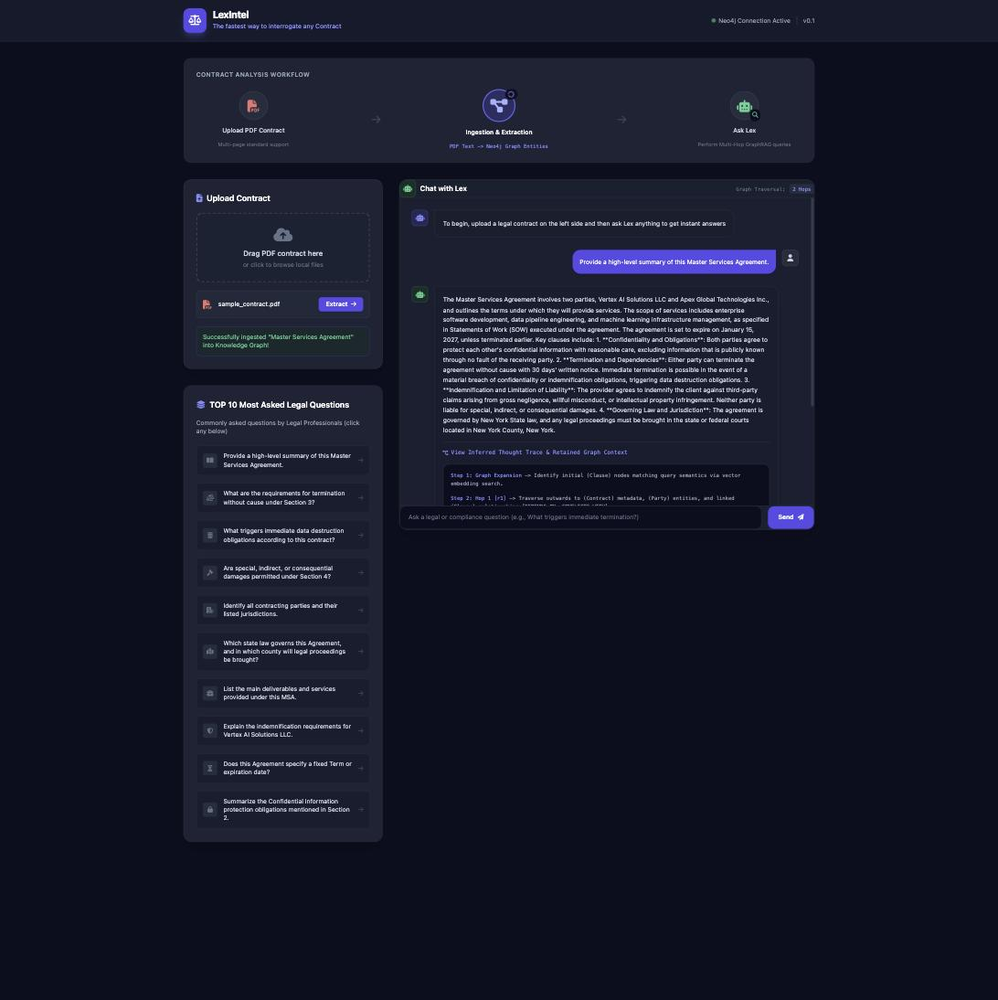

# ⚖️ LexIntel — Legal Contract & Compliance Knowledge Graph

**An enterprise-grade GraphRAG engine that turns raw PDF contracts into a queryable Neo4j knowledge graph, then answers legal & compliance questions with grounded, explainable, multi-hop retrieval.**

[](https://openjdk.org/projects/jdk/21/)
[](https://spring.io/projects/spring-boot)
[](https://spring.io/projects/spring-ai)
[](https://neo4j.com/)
[](https://tika.apache.org/)
[](https://platform.openai.com/)
[](LICENSE)

---

## Overview

LexIntel ingests multi-page commercial contracts (PDF), uses an LLM to structurally extract legal entities, clauses, and obligations, and persists them as a **Knowledge Graph** in Neo4j. Instead of naive vector-only RAG, queries traverse the graph (contract → clause → party relationships such as `DEPENDS_ON` / `CONFLICTS_WITH`) to assemble grounded context before synthesizing an answer — with a full explainability trace of how that context was retrieved.

## Features

- 📄 **PDF Contract Ingestion** — Apache Tika extracts raw text from multi-page contracts.
- 🧠 **LLM-Structured Extraction** — Spring AI + GPT-4o parse unstructured legal text into typed entities (`Contract`, `Clause`, `Party`).
- 🕸️ **Knowledge Graph Construction** — Extracted entities and relationships are persisted in Neo4j (graph + vector search).
- 🔍 **GraphRAG Querying** — Multi-hop graph traversal retrieves grounded context for legal/compliance questions, instead of flat vector-only retrieval.
- 🔎 **Explainability** — Every answer includes a "thought trace" showing the graph expansion, hop traversal, and retained context used to generate it.
- 💻 **Built-in Web Dashboard** — Drag-and-drop contract upload and a chat interface for interrogating the graph, with a library of common legal questions.
- ⚡ **Java 21 Virtual Threads** — high-throughput I/O for concurrent ingestion and querying.

## Screenshots

| LexIntel Dashboard with Explainability section|
|---|
|  | 

## Architecture

```
PDF Contract
    │
    ▼
Apache Tika (text extraction)
    │
    ▼
Spring AI + GPT-4o (structured entity/clause extraction)
    │
    ▼
Neo4j Knowledge Graph  (Contract ─HAS_CLAUSE─▶ Clause ─DEPENDS_ON/CONFLICTS_WITH─▶ Clause)
                       (Contract ─HAS_PARTY──▶ Party)
    │
    ▼  (multi-hop graph traversal + vector search on user question)
GraphRAG Service ──▶ GPT-4o (grounded answer synthesis) ──▶ Explainable response
```

## Tech Stack

| Layer | Technology |
|---|---|
| Language / Runtime | Java 21 (Virtual Threads) |
| Application Framework | Spring Boot 3.3.2 |
| AI Orchestration | Spring AI 1.0.0-M1 |
| LLM | OpenAI GPT-4o |
| Graph Database | Neo4j 5.18 Enterprise (Graph + Vector Search, APOC) |
| Document Parsing | Apache Tika 2.9.2 |
| Frontend | Static HTML/JS dashboard (Tailwind CSS, Font Awesome, served by Spring Boot) |
| Build Tool | Maven |

## Quickstart

### Prerequisites

- Java 21 (JDK)
- Maven (or use the included `./mvnw` wrapper)
- Docker (for Neo4j)
- An [OpenAI API key](https://platform.openai.com/api-keys)

### 1. Start Neo4j

```bash
docker-compose up -d
```

This starts Neo4j 5.18 Enterprise with the APOC plugin, exposing the Bolt protocol on `7687` and the browser UI on [`7474`](http://localhost:7474) (default credentials: `neo4j` / `password123`, configured in `docker-compose.yml`).

### 2. Set your OpenAI API key

```bash
export OPENAI_API_KEY=sk-...
```

### 3. Run the application

```bash
./mvnw spring-boot:run
```

### 4. Open the dashboard

Navigate to **[http://localhost:8080](http://localhost:8080)**, drag in a PDF contract (a `sample_contract.pdf` is included in the repo root for testing), click **Extract**, then ask a question in the chat panel — or click one of the sample questions in the library.

## API Reference

All endpoints are under `/api/v1/legal`.

| Method | Endpoint | Description |
|---|---|---|
| `POST` | `/contracts/ingest` | Multipart PDF upload. Parses, extracts entities via LLM, and persists the contract into the Neo4j knowledge graph. |
| `POST` | `/query` | Body: `{ "question": "..." }`. Runs a GraphRAG query — graph traversal + vector search — and returns a grounded answer plus the retained graph context. |

**Example:**

```bash
curl -X POST http://localhost:8080/api/v1/legal/contracts/ingest \
  -F "file=@sample_contract.pdf"

curl -X POST http://localhost:8080/api/v1/legal/query \
  -H "Content-Type: application/json" \
  -d '{"question": "What triggers immediate termination?"}'
```

## Configuration

Configuration lives in `src/main/resources/application.yml`:

| Property | Description | Default |
|---|---|---|
| `spring.neo4j.uri` | Bolt URI for Neo4j | `bolt://localhost:7687` |
| `spring.neo4j.authentication.username` / `.password` | Neo4j credentials | `neo4j` / `password123` |
| `spring.ai.openai.api-key` | OpenAI API key | `${OPENAI_API_KEY}` (env var) |
| `spring.ai.openai.chat.options.model` | Chat model used for extraction & answering | `gpt-4o` |
| `spring.ai.openai.chat.options.temperature` | Sampling temperature (low, for accurate extraction) | `0.1` |
| `server.port` | Application port | `8080` |

> For production use, replace the hardcoded Neo4j credentials in `docker-compose.yml` / `application.yml` with environment-variable-backed secrets.

## Deployment

**Neo4j** — `docker-compose.yml` runs Neo4j locally for development. For production, point `spring.neo4j.uri` at a managed instance (e.g. [Neo4j Aura](https://neo4j.com/cloud/aura/)) or a self-hosted Neo4j Enterprise cluster.

**Application** — Spring Boot's built-in Cloud Native Buildpacks support lets you build a container image without a Dockerfile:

```bash
./mvnw spring-boot:build-image
docker run -p 8080:8080 \
  -e OPENAI_API_KEY=sk-... \
  -e SPRING_NEO4J_URI=bolt://<neo4j-host>:7687 \
  legal-graph-rag:0.0.1-SNAPSHOT
```

Deploy the resulting image to any container platform (ECS, Cloud Run, Azure Container Apps, Kubernetes, etc.), configuring `OPENAI_API_KEY` and `SPRING_NEO4J_URI`/credentials as environment variables.

## Project Structure

```
src/main/java/com/enterprise/legal/
├── controller/   # REST endpoints (ingestion, GraphRAG query)
├── domain/       # Neo4j graph entities: Contract, Clause, Party
├── dto/          # Request/response payloads
├── repository/   # Spring Data Neo4j repositories
└── service/      # Ingestion pipeline & GraphRAG query logic
src/main/resources/
├── application.yml
└── static/index.html   # LexIntel web dashboard
```

## License

Distributed under the MIT License. See [`LICENSE`](LICENSE) for details.
